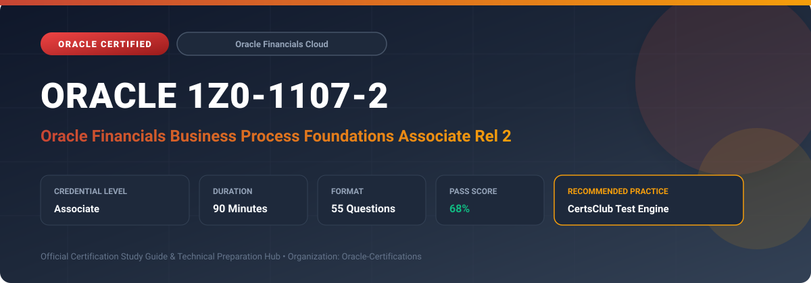

  

# Oracle 1Z0-1107-2: Oracle Financials Business Process Foundations Associate Rel 2

---

## 1. Exam Overview & Candidate Profile

The **Oracle 1Z0-1107-2: Oracle Financials Business Process Foundations Associate Rel 2** credential confirms foundational understanding of core enterprise financial business processes.

Candidates demonstrate end-to-end knowledge in Record to Report, Invoice to Cash, Procure to Pay, Asset to Retirement, and Financial Period Close procedures.

### Target Audience & Prerequisites
- **Target Roles**: Implementation Specialists, Cloud Architects, Technical Leads, Enterprise Consultants, and Systems Engineers.
- **Recommended Experience**: 1–2 years of practical, hands-on experience designing, implementing, and maintaining corresponding Oracle solutions.
- **Credential Earned**: Associate Certification.

---

## 2. Key Exam Specifications

| Specification | Details |
| :--- | :--- |
| **Exam Code** | **Oracle 1Z0-1107-2** |
| **Official Title** | Oracle Financials Business Process Foundations Associate Rel 2 |
| **Certification Track** | Oracle Financials Cloud |
| **Exam Duration** | 90 Minutes |
| **Number of Questions** | 55 Questions |
| **Passing Score** | 68% |
| **Question Format** | Multiple Choice (Single/Multiple Answer), Scenario-Based Questions |
| **Delivery Provider** | Oracle University / Pearson VUE (Online Proctored or Test Center) |
| **Recommended Practice Engine** | [CertsClub Oracle Practice Tests](https://www.certsclub.com/oracle/1z0-1107-2-dumps.html) |

---

## 3. Official Blueprint & Exam Domain Breakdown

The examination assesses candidate competencies across core functional domains weighted as follows:

| Domain Area | Weighting |
| :--- | :--- |
| **Record to Report (General Ledger & Financial Reporting)** | `30%` |
| **Invoice to Cash (Receivables & Collections)** | `25%` |
| **Procure to Pay (Payables & Payments)** | `25%` |
| **Asset to Retirement (Fixed Assets Management)** | `10%` |
| **Accounting Period Close & Financial Governance** | `10%` |

---

## 4. Deep Dive into Complex & Challenging Technical Topics

To secure a passing score on the 1Z0-1107-2 exam, candidates must master the following advanced concepts:

- Chart of Accounts (COA) structure: balancing segments, cost centers, and natural account hierarchies.
- General Ledger journal creation, allocation rules, foreign currency revaluation, and translation.
- Accounts Payable invoice matching (2-way, 3-way, 4-way), payment processing, and withholding taxes.
- Accounts Receivable invoicing, receipt applications, credit management, and customer collections.
- Subledger Accounting (SLA) rule configuration and period-end reconciliation.

---

## 5. Scenario-Based Demo & Practice Questions

### Question 1
In the Procure to Pay business flow, what type of invoice matching validates that the invoice quantities and amounts match both the purchase order and the physical receipt document?

A) 3-Way Matching
B) 2-Way Matching
C) 4-Way Matching
D) Evaluated Receipt Settlement

- **Correct Answer**: `A) 3-Way Matching`  
- **Technical Explanation**: 3-way matching compares invoice line quantities, unit prices, and amounts against both the corresponding Purchase Order and the Goods Receipt document before authorizing payment.

---

### Question 2
Which core financial process culminates in balancing journal entries, intercompany eliminations, financial statement consolidation, and closing accounting periods?

A) Record to Report (R2R)
B) Order to Cash (O2C)
C) Source to Pay (S2P)
D) Plan to Produce (P2P)

- **Correct Answer**: `A) Record to Report (R2R)`  
- **Technical Explanation**: Record to Report encompasses all subledger accounting entries, general ledger adjustments, consolidation, financial reporting, and the formal period close.

---

## 6. Recommended Preparation Strategy & Practice Testing Engine

Achieving certification in **Oracle 1Z0-1107-2** requires balanced theoretical study and scenario-based simulation practice:

1. **Review Oracle Documentation**: Master architecture guides, implementation workbooks, and administration manuals on the Oracle Help Center.
2. **Hands-on Lab Practice**: Execute real-world configuration, policy setup, and troubleshooting tasks in your cloud tenancy or test instance.
3. **Simulated Exam Drills**: Practice answering timed, scenario-based multiple-choice questions to familiarize yourself with the question formats, traps, and timing constraints.

### Practice With CertsClub
For realistic practice questions, updated dumps, and mock testing environments:
- **Resource**: [CertsClub Oracle Practice Test Engine](https://www.certsclub.com/oracle/1z0-1107-2-dumps.html)
- **Special Discount**: Use coupon code **`club20`** during checkout for an instant **20% discount** on all practice exam bundles and testing engines.

---

## 7. Official Documentation & References

- [Oracle University Certification Registry](https://education.oracle.com/)
- [Oracle Help Center Documentation Portal](https://docs.oracle.com/)
- [Oracle Cloud Infrastructure & Applications Guides](https://docs.oracle.com/en/cloud/)
- [CertsClub Oracle Certification Exam Practice](https://www.certsclub.com/oracle/1z0-1107-2-dumps.html)

---

## 8. SEO & Discovery Keywords

`oracle 1z0-1107-2, oracle 1z0-1107-2 exam, oracle 1z0-1107-2 dumps, 1Z0-1107-2 practice questions, 1Z0-1107-2 study guide, oracle financials business process foundations associate rel 2, certsclub 1z0-1107-2`